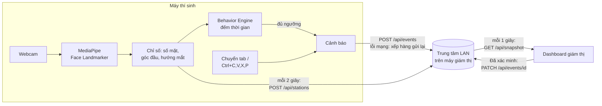

# Tổng quan hệ thống

## Bài toán

Trong phòng thi trên máy tính, một giám thị khó quan sát cùng lúc 15–30 màn hình. AI ExamGuard
dùng webcam của từng máy để phát hiện sớm các dấu hiệu cần chú ý (vắng mặt, có người lạ, quay đầu
lâu, nhìn ra ngoài, chuyển tab…) và báo về máy giám thị. **AI không kết luận gian lận**; giám thị
xem cảnh báo, đối chiếu thực tế và tự đánh dấu "đã xác minh".

## Ba vai trò

| Vai trò | Trang | Việc chính |
| --- | --- | --- |
| Thí sinh | `/thi-sinh` | Nhập họ tên, SBD, phòng, số máy → kết nối máy giám thị → đồng ý giám sát → bật webcam |
| Giám thị | `/giam-thi` | Xem sơ đồ máy (xanh/vàng/đỏ/mất kết nối), luồng cảnh báo, xác minh, xuất CSV |
| Quản trị | `/quan-tri` | Đặt tên phòng, ngưỡng thời gian, tùy chọn quyền riêng tư, xuất cấu hình JSON |

## Dữ liệu đi như thế nào?



Video **không rời khỏi máy thí sinh**. Chỉ có các con số (số khuôn mặt, góc ước tính, FPS) và
sự kiện cảnh báo được gửi đi.

## Ba chế độ chạy

Các màn hình không biết đang chạy chế độ nào; chúng chỉ gọi `web/src/services/exam-sync.ts`,
file này gửi dữ liệu tới mọi kênh đang có:

| Chế độ | Khi nào | Phạm vi |
| --- | --- | --- |
| **LAN (chính)** | Chạy bằng EXE, hoặc trang web đã nhập địa chỉ máy giám thị | Nhiều máy trong cùng mạng LAN/Wi-Fi, không cần Internet |
| **Firebase** | Có cấu hình `NEXT_PUBLIC_FIREBASE_*` khi build web | Nhiều máy qua Internet (cần bổ sung bảo mật trước khi dùng thật) |
| **Demo cục bộ** | Luôn chạy song song | Chỉ các tab trong cùng một trình duyệt; dùng để trình diễn |

Khi trung tâm LAN hoặc Firebase đã trả lời, dữ liệu từ đó được coi là chính thức và dữ liệu demo
không ghi đè lên nữa.

## Cách đóng gói

```text
web/  ──npm run build──▶ web/out/ (HTML/JS tĩnh + mô hình AI)
                              │
desktop-hub/ (Python) ────────────┴──PyInstaller──▶ 1 file EXE
```

Hai phần dùng hai ngôn ngữ (TypeScript và Python) nhưng chỉ nối với nhau qua hai điểm: thư mục
`web/out` và API LAN. Các giá trị hai bên phải khớp (cổng, phiên bản, trường bắt buộc, loại cảnh báo)
được ghi trong `shared/hub-contract.json` và kiểm tra tự động ở cả hai phía.

Một EXE dùng cho mọi máy. Máy giáo viên mở trang Giám thị và đọc địa chỉ LAN của mình
(ví dụ `http://192.168.1.10:8765`); máy học sinh nhập địa chỉ đó ở trang Thí sinh.

## Đọc tiếp

- Quy tắc tạo cảnh báo: [nghiep-vu/quy-tac-canh-bao.md](nghiep-vu/quy-tac-canh-bao.md)
- Cấu trúc code: [web/README.md](../web/README.md), [desktop-hub/README.md](../desktop-hub/README.md)
