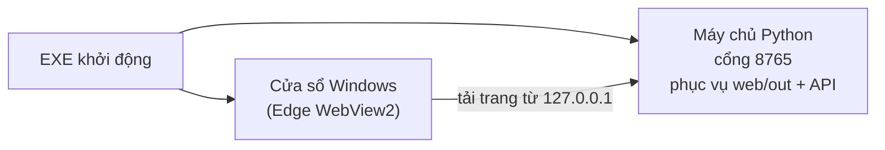

# Tổng quan hệ thống

Nội dung nghiệp vụ trong tài liệu này thống nhất với hồ sơ dự thi
(`tai-lieu-du-thi/Ho_so_du_an_AI_ExamGuard.docx`).

## 1. Bài toán

Trong kỳ thi trên máy tính, một giám thị phải quan sát cùng lúc nhiều thí sinh. Các dấu hiệu cần chú ý
(rời vị trí, có thêm người trước webcam, quay đầu lâu, liên tục nhìn lệch màn hình) có thể xảy ra trong thời gian
ngắn và bị bỏ sót khi giám thị đang nhìn chỗ khác.

AI ExamGuard là **"trợ lý quan sát"**: AI nhận biết tín hiệu, Behavior Engine kiểm tra tín hiệu có kéo dài đủ lâu
không, rồi gửi cảnh báo để **giám thị kiểm tra thực tế và quyết định**. AI không kết luận gian lận.

Ví dụ đời thường: giống **cảm biến lùi xe**. Cảm biến không lái xe thay người, nó chỉ kêu "bíp bíp" khi có vật
ở gần quá lâu, còn người lái quay lại nhìn và quyết định. AI ExamGuard cũng vậy: chỉ "bíp" khi một dấu hiệu
kéo dài đủ lâu, giám thị là người nhìn và quyết định.

## 2. Đối tượng và mục tiêu

| Đối tượng | Trang | Việc chính |
| --- | --- | --- |
| Thí sinh | `/thi-sinh` | Khai báo họ tên, SBD, phòng, số máy → kết nối máy giám thị (gõ mã 4 số hoặc địa chỉ) → đồng ý giám sát → bật webcam |
| Giám thị | `/giam-thi` | Mã kết nối + địa chỉ cho học sinh, sơ đồ máy (xanh/vàng/đỏ/mất kết nối), luồng cảnh báo kèm tiếng báo động, xem chi tiết, đánh dấu đã xác minh, xuất CSV |
| Nhà trường / đơn vị tổ chức | `/quan-tri` | Đặt tên phòng, ngưỡng thời gian, tùy chọn quyền riêng tư, xuất cấu hình JSON |

Bốn mục tiêu:

1. Dùng AI thị giác nhận biết một số tín hiệu quan sát được qua webcam.
2. Tránh "vừa quay đầu đã báo": tín hiệu phải kéo dài đủ ngưỡng mới thành cảnh báo.
3. Cảnh báo phải đúng **phòng – máy – thí sinh – loại tín hiệu – thời điểm**.
4. Con người luôn giữ quyết định cuối cùng.

Phạm vi tín hiệu: không thấy khuôn mặt, nhiều khuôn mặt, quay đầu trái/phải kéo dài, cúi/ngẩng kéo dài, hướng mắt lệch,
và các thao tác trong cửa sổ ứng dụng (rời cửa sổ bài thi, Ctrl/Cmd + C/V/X/P). Chi tiết ngưỡng:
[nghiep-vu/quy-tac-canh-bao.md](nghiep-vu/quy-tac-canh-bao.md).

## 3. Quy trình vận hành

| Bước | Diễn ra |
| --- | --- |
| 0. Mở máy giám thị | Giáo viên mở EXE → trang Giám thị hiện mã kết nối 4 số và địa chỉ LAN hiện tại của máy |
| 1. Chuẩn bị phiên thi | Thí sinh nhập họ tên, SBD, mã phòng, số máy, rồi gõ mã kết nối (hoặc địa chỉ); hệ thống kiểm tra kết nối trước khi cho bắt đầu |
| 2. Bật webcam | Thí sinh đọc thông báo và xác nhận đồng ý; chỉ sau đó webcam mới mở. Không thu âm, không bật camera bí mật |
| 3. AI phân tích | MediaPipe Face Landmarker tìm khuôn mặt và điểm mốc → số mặt, góc quay, góc cúi/ngẩng, hướng mắt |
| 4. Behavior Engine theo dõi | Đếm thời gian tín hiệu; chưa đủ ngưỡng thì chưa cảnh báo, nhiễu ngắn và camera đứng hình không được tính |
| 5. Gửi sự kiện | Đủ ngưỡng → gửi qua LAN tới máy giám thị; mất mạng thì giữ lại và gửi lại |
| 6. Giám thị xác minh | Dashboard hiện phòng, máy, họ tên, SBD, loại tín hiệu, thời điểm, trạng thái xác minh; sự kiện vẫn được giữ khi thí sinh đã trở lại bình thường |

## 4. Dữ liệu đi như thế nào?


Trước đó, máy thí sinh tìm máy giám thị bằng **mã kết nối**: khi trang Giám thị đang mở, trung tâm trên máy
giáo viên cứ 2 giây phát một gói tin UDP quảng bá (cổng `8766`) mang mã 4 số, tên phòng và cổng. EXE trên
máy thí sinh nghe được gói đó, nên khi học sinh gõ đúng mã, trang thí sinh biết ngay địa chỉ để kết nối.
Mạng chặn quảng bá thì học sinh gõ địa chỉ như cũ. Chi tiết: [ky-thuat/api-lan.md](ky-thuat/api-lan.md).

Video **không rời khỏi máy thí sinh**. Chỉ có các con số (số khuôn mặt, góc ước tính, FPS) và sự kiện cảnh báo
được gửi đi. Danh tính do thí sinh khai báo; sản phẩm không nhận diện danh tính bằng khuôn mặt.

## 5. Hai phần mềm và vai trò

| Phần | Ngôn ngữ | Vai trò |
| --- | --- | --- |
| `web/` | TypeScript (Next.js) | **Frontend + AI**: 4 trang giao diện, nhận diện khuôn mặt, bộ đếm hành vi, hàng đợi gửi lại |
| `desktop-hub/` | Python | **Backend + vỏ ứng dụng**: trung tâm cảnh báo LAN (API, lưu dữ liệu trong bộ nhớ), phục vụ giao diện, cửa sổ ứng dụng và cửa sổ giám thị riêng |
| `shared/` | JSON | Hợp đồng chung: cổng, phiên bản, trường bắt buộc, loại cảnh báo — được kiểm tra tự động ở cả hai phía |

Hai phần chỉ nối với nhau qua hai điểm: thư mục `web/out` (giao diện đã build) và API LAN `/api/...`.



Vì sao học sinh nên dùng EXE thay vì trình duyệt: trình duyệt chỉ cho bật webcam trên `localhost` hoặc HTTPS.
EXE tải giao diện từ `127.0.0.1` nên webcam hoạt động; mở bằng trình duyệt qua địa chỉ LAN thì webcam bị chặn.
Trang Giám thị không cần webcam nên giáo viên có thể mở bằng trình duyệt thường qua `http://<IP máy giáo viên>:8765/giam-thi`.

## 6. Ba chế độ đồng bộ

Các màn hình chỉ gọi `web/src/services/exam-sync.ts`, file này gửi dữ liệu tới mọi kênh đang có:

| Chế độ | Khi nào | Phạm vi |
| --- | --- | --- |
| **LAN (chính)** | Chạy bằng EXE, hoặc trang web đã nhập địa chỉ máy giám thị | Nhiều máy trong cùng mạng LAN/Wi-Fi, không cần Internet |
| **Firebase** | Có cấu hình `NEXT_PUBLIC_FIREBASE_*` khi build web | Nhiều máy qua Internet (cần bổ sung bảo mật trước khi dùng thật) |
| **Kênh cục bộ trong trình duyệt** | Luôn chạy song song | Chỉ các tab/cửa sổ trong cùng một trình duyệt. Không thay được LAN/Firebase: thí sinh vẫn phải kết nối máy giám thị mới bắt đầu được |

Khi trung tâm LAN hoặc Firebase đã trả lời, dữ liệu từ đó được coi là chính thức và dữ liệu demo không ghi đè lên nữa.

## 7. Cách đóng gói

```text
web/          ──npm run build──▶  web/out/  (HTML/JS tĩnh + mô hình AI)
                                     │
desktop-hub/  ───────────────────────┴──PyInstaller──▶  1 file EXE (release/)
```

Một EXE dùng cho mọi máy. Máy giáo viên mở trang Giám thị và thấy mã kết nối cùng địa chỉ LAN của mình
(ví dụ `4821` và `http://192.168.1.10:8765`); máy học sinh gõ mã đó (hoặc địa chỉ) ở trang Thí sinh.

## 8. Hạn chế và hướng cải tiến

Hạn chế hiện tại (theo hồ sơ dự án):

1. Khả năng quan sát phụ thuộc chất lượng webcam, ánh sáng, khoảng cách và tư thế ngồi.
2. Góc quay đầu, cúi/ngẩng, hướng mắt là giá trị ước tính, không phải bằng chứng độc lập để kết luận vi phạm.
3. Face Landmarker phân tích khuôn mặt; sản phẩm **không** nhận diện điện thoại.
4. Cúi đầu lâu có thể chỉ là đang viết nháp — cảnh báo chỉ nhắc giám thị quan sát thêm.
5. Bản LAN cần thử thêm với nhiều máy thí sinh trước khi dùng cho phòng thi quy mô lớn.

Hướng cải tiến: thử với nhiều học sinh, webcam và điều kiện ánh sáng; hiệu chỉnh ngưỡng theo kết quả thử nghiệm;
bổ sung bảo mật và phân quyền; kiểm thử nhiều máy cùng kết nối một máy giám thị; cải thiện giao diện cảnh báo.
Các vấn đề kỹ thuật cụ thể: [van-de-ton-dong.md](van-de-ton-dong.md).

## Đọc tiếp

- Quy tắc tạo cảnh báo: [nghiep-vu/quy-tac-canh-bao.md](nghiep-vu/quy-tac-canh-bao.md)
- Cấu trúc code: [web/README.md](../web/README.md), [desktop-hub/README.md](../desktop-hub/README.md)
- Đối chiếu 32 bước phát triển với code: [ky-thuat/doi-chieu-32-buoc.md](ky-thuat/doi-chieu-32-buoc.md)
